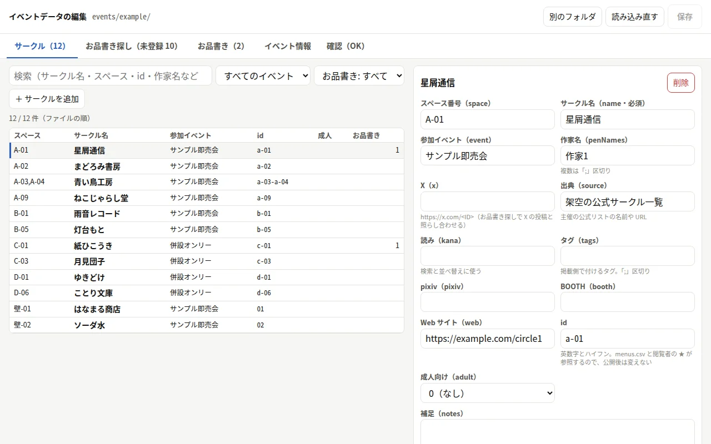
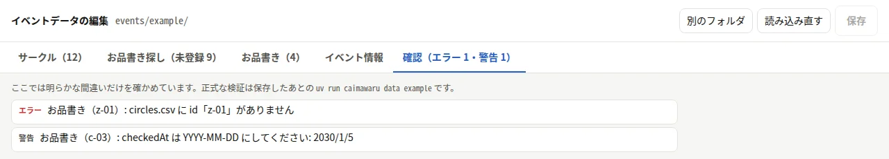
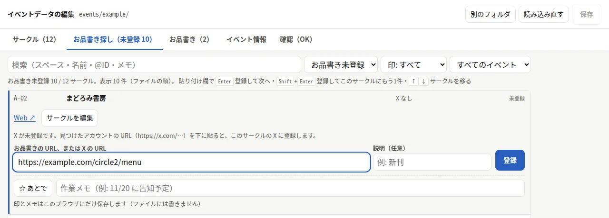

# エディタ（GUI でイベントデータを編集する）

イベントデータ（event.json・data/circles.csv・data/menus.csv）は、ブラウザのエディタで編集できます。
CSV を直接書いたりコマンドを覚えたりしなくても、サークルとお品書きを登録できます。全体の手順は [getting-started.md](getting-started.md)。

## 使い方

- File System Access API（`showDirectoryPicker`）を使うので、PC の Chrome・Edge だけで動く。Firefox・Safari・スマホでは使えない旨を表示する
- `pnpm build:editor` で `dist/editor/` に静的なページを作れる。`localhost` 以外に置くときは HTTPS が必要（ブラウザの制限）

```sh
pnpm editor        # 表示された URL（http://localhost:5173/ など）を PC の Chrome か Edge で開く
```

1. 「イベントのフォルダを選ぶ」で `events/<eventId>/` を選び、ファイルの編集を許可する（リポジトリや `events/` を選ぶと、中のイベントから選べる）
2. サークル（検索・絞り込み・追加・編集・削除）、お品書き（URL・説明・確認した日）、イベント情報（event.json の storeId・title・info）を編集する

   
3. 「保存」（Ctrl+S）で同じフォルダに書き戻す（編集したファイルだけ。CSV は CLI と同じ [event-data.md の「CSV の書き方」](event-data.md#csv-の書き方保存時の形) の形）
4. ターミナルで `uv run caimawaru data <eventId>` を実行して検証し、`circles.json` を作り直す（エディタからは実行しない）

- ファイルを読み書きするのはブラウザだけで、選んだフォルダの3つのファイルだけ（layout.json・sources/・circles.json は触らない）。ファイルはどこにも送らない
- 保存の前に、読み込んだ後でほかに（CLI・エージェント・別のエディタなど）変更されたファイルがないかを確かめ、あれば上書きせずに「読み込み直す」よう知らせる
- 画面での確認（必須の列・URL の形・adult・id の重複・宙に浮いたお品書き）は簡単なものだけ。正式な検証は `uv run caimawaru data`

  
- サークルを消すときは、そのサークルのお品書きも一緒に消すか、やめるかを選ぶ。id を変えるときは、お品書きの id も付け替える
- お品書きの URL は自分で貼り付ける（エディタは X などのページを読み込まない）

## お品書き探し

お品書きは「お品書き探し」タブで、サークルを1つずつ回って登録する:



- 1行が1サークル（ファイルの順）。「お品書き未登録」「登録済み」、作業用の印、参加イベントで絞り込み、スペース・名前・@ID・メモで検索する（`/` で検索欄へ、Enter・↓ で先頭のサークルを開く）
- 開いたサークルの「X を開く」でサークルの X を新しいタブで開き、見つけた投稿の URL を貼り付けて **Enter で登録して次のサークルへ**、**Shift+Enter で登録して同じサークルに残る**（2投稿目）。↑↓ でサークルを移る
- X の投稿 URL は CLI（`caimawaru menu`）と同じく `https://x.com/<ID>/status/<番号>` にそろえて登録する（`twitter.com`・`?s=20` などを落とす）。
  投稿したアカウントがサークルの X と違うとき・同じ URL がほかのサークルにあるときは知らせる（登録は止めない）。同じサークルに同じ URL があれば登録しない
- すでにお品書きがあるサークルは「登録のしかた」で、追加するか、どれを差し替えるか（URL と確認した日が変わる）を選ぶ
- X が空のサークルには X のリンクは出ない。見つけたアカウントの URL（`https://x.com/<ID>`）を貼ると、そのサークルの `x` 列に登録する。
  X が空のサークルに投稿を登録するときは、投稿したアカウントを `x` 列にも入れられる（既定はオフ。ほかのサークルの X なら出さない）。載せるアカウントかどうかは運用者が判断する
- 投稿したアカウントがほかのサークルの X なら、このサークルの X が空でも知らせる
- 「☆ あとで」と作業メモは、このブラウザ（localStorage）にだけ保存し、イベントのファイルには書かない（別のブラウザ・PC とは共有されない）
- 「お品書き」タブはすべてのお品書きの一覧で、サークルの付け替え（検索して選ぶ）と、宙に浮いたもの・確かめたいもの（投稿者が違う・重複）の絞り込みができる

## サークルの登録と変更

- 「＋ サークルを追加」でスペース番号の欄に入る。スペース番号 → サークル名 → 参加イベント → 作家名 → X → 出典の順に Tab で進める。
  参加イベントと出典が空なら、ほかの欄を入れたときに直前のサークルと同じ値が入る。Ctrl+Enter（「続けてサークルを追加」）で次のサークルへ
- スペース番号を、ほかのサークルが使っている番号に変えると知らせ、「入れ替える」で相手を元のスペースへ移せる（どちらの id も変えない）
- id 列が空のサークル（id はスペース番号から作る）のスペース番号を変えるときは、id をそのままにするか（id 列に今の id を書く。公開後はこちら）、
  id も変えてお品書きを付け替えるかを選ぶ
- `storeId` は公開後に変えない（画面でも、確認のチェックを入れないと変えられない）
