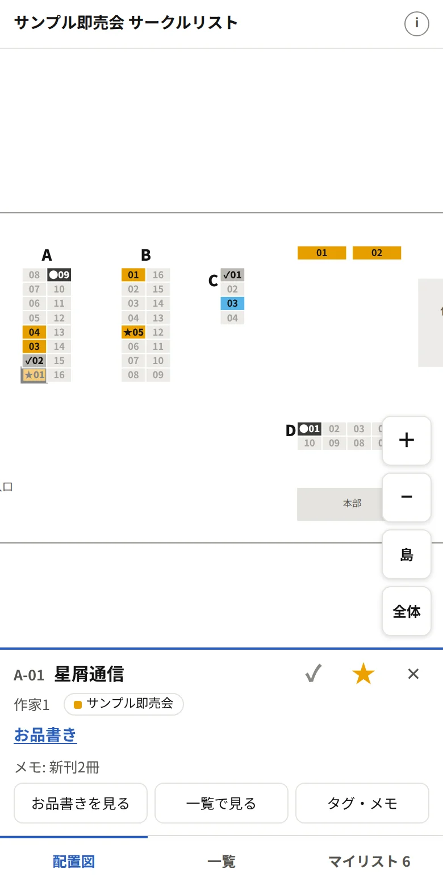
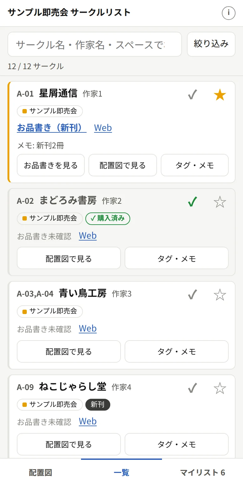
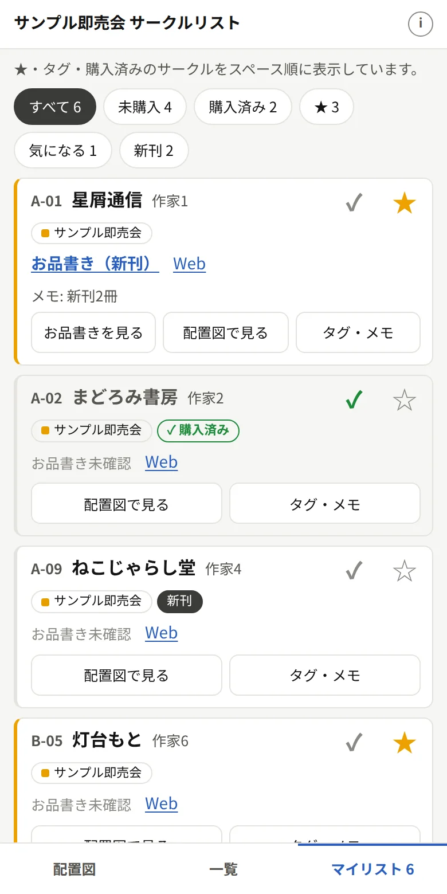
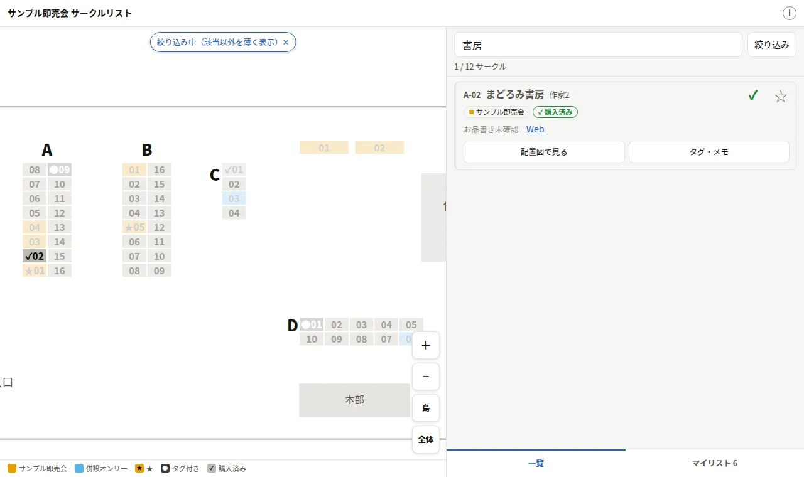
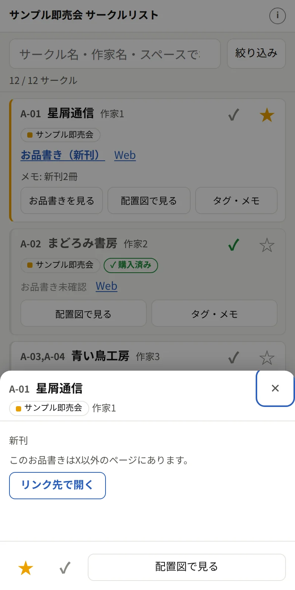

# ページの機能（閲覧者から見たもの）

ビルドしたページ（`pnpm build <eventId>` → `dist/<eventId>/`）で、当日の参加者ができること。

スマホでの利用を前提に、画面下のタブで切り替える。幅 900px 以上（PC・タブレット横）では左に配置図、右に一覧・マイリストを並べる。

  
  
  

- **配置図**: 2本指で拡大縮小・1本指で移動・ダブルタップで拡大（PCはホイール）。＋／−、「島」（サークル配置部分）、「全体」ボタン
  - スペースをタップするとサークル情報を表示（★・タグ・メモ、お品書きのシート、一覧への移動）
  - イベント色は `event.json` の `info.eventSlots`（イベント名 → 枠 1〜5）で割り当て、色は `info.slotColors` で上書きできる（[event-data.md](event-data.md#eventjson)）。枠のないイベントは灰色の「同時開催」
  - ★は黄＋★記号、タグ付きは濃い灰色＋●記号、購入済みは薄い灰色＋✓記号で表示（色だけに頼らない）。一覧で絞り込み中は該当以外を薄く表示
  - 配置図は公式配置図を元に `layout.json` に描き起こしたもの（公式画像は転載しない。[layout.md](layout.md)）。`layout.json` がないイベントは配置図なしで一覧とマイリストだけになる
- **一覧**: 検索（サークル名・作家名・イベント・スペース・自分のタグ・メモ）、絞り込み（イベント・★/タグ・お品書き有無）、並べ替え
  - 各カードに ✓（購入済みにする）・☆（★を付ける）と「お品書きを見る」「配置図で見る」「タグ・メモ」

  
- **お品書きのシート**: 「お品書きを見る」で画面下からシートを開き、X 公式の埋め込みで投稿を表示（押すまで X のスクリプトは読み込まない）
  - 複数あるときは ‹ › で切り替え。X 以外（pixiv・BOOTH 等）はリンク先を開くボタン
  - ✕・背景タップ・Esc・スマホの「戻る」で閉じる（履歴を1つ積むので、戻ってもページから離れない）
  - シートの下から ★ と「配置図で見る」

  
- **マイリスト**: ★・タグ・購入済みのサークルをスペース順に表示（会場を回る順）。未購入・購入済み・★・タグごとに絞り込み
- **購入済み**: 当日買ったら ✓。配置図では灰色＋✓ になり、まだ回っていない★・タグが目立つ
- 自分用のタグは「気になる」「新刊」「グッズ」のほか自由に追加できる
- ★・タグ・メモはブラウザの localStorage のみに保存（旧形式の「絶対行く」「気になる」は自動で ★ と「気になる」タグに移行）
- **設定**（画面上部の「i」）: 表示テーマ（自動・ライト・ダーク）と、★・購入済み・タグ・メモの書き出し（ファイル保存・コピー）／読み込み（ファイル・貼り付け。読み込む前に内容を表示し、「今の内容に追加」か「置き換える」を選ぶ）

公開するページには `noindex` を付けている（イベント後に古い情報が検索に残らないように）。
